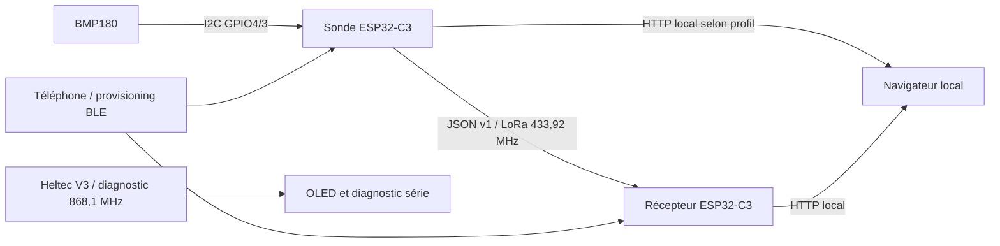

# Architecture de référence

## Vue des flux



## Composants et frontières

| Composant | Responsabilité | Contrainte |
| --- | --- | --- |
| Sketch EnviroTerminal | Orchestration, acquisitions, reprise capteur | Cadence nominale 2 s |
| `Bmp180Compensation.h` | Calcul et rejet des données incohérentes | Fonctions testées à la compilation |
| `I2cBusRouter.h`, `Lcd1602.*` | Sélection du bus et écran optionnel | Un contrôleur I2C, broches libérées au changement |
| `WeatherLoRaTx.*`, `Sx127xDiagnostics.*` | Transmission asynchrone et santé SPI | 120 s minimum, timeout TX 2 s |
| `WeatherRadioConfig.h` | Paramètres communs météo | 433 920 000 Hz, BW 31 250, 8 dBm nominaux |
| `WeatherReceiver/src/main.cpp` | RX, validation JSON, diagnostic radio | Publication uniquement après validation |
| `WebDashboard.*`, `WebDashboardPage.h` | BLE, Wi-Fi, API, HTML et états UI | Réutilisés par le récepteur |
| `PlantHubDiagnostic/src/main.cpp` | SX1262 RX, OLED, PRG, veille | Projet autonome ESP32-S3, 868,1 MHz |

Le récepteur inclut actuellement le `.cpp` du tableau de bord commun depuis
son propre `WebDashboard.cpp`. C'est une dépendance explicite de l'existant ;
une extraction en bibliothèque partagée n'est pas nécessaire à cette adoption.

## Contrats de données existants

Paquet météo : `v=1`, `node="meteo-1"`, `seq` et `uptime_ms` entiers non signés
32 bits, `temperature_c` et `pressure_hpa` numériques et finis. Exemple fictif :

```json
{"v":1,"node":"meteo-1","seq":4,"uptime_ms":483845,"temperature_c":22.2,"pressure_hpa":1008.05}
```

Le récepteur exige ces champs mais ne fournit pas encore d'anti-rejeu ou
de déduplication par séquence. Le filtre de nom et le CRC ne constituent pas
une authentification. La séquence recommence au redémarrage de la sonde.

`GET /api/status` publie les mesures et états ; à l'âge limite, les valeurs
deviennent nulles. Le seuil est **strictement inférieur** à 180 000 ms en RX,
7 000 ms par défaut en local. `GET /api/device` décrit identité et capacités ;
`GET /api/radio` est fourni par le récepteur. Découverte `_enviro._tcp.local`
sur le réseau local ; aucun mécanisme de découverte Internet.

## Décisions pour la consolidation

- **ADR1 : conserver les profils.** La cible utilisée par défaut à la racine est
  `enviroterminal_diag`. Pour vérifier la station installée, sélectionner
  explicitement `enviroterminal_local_web_meteo_tx` puis le projet RX.
- **ADR2 : conserver le contrat radio v1.** La campagne de mesure et ses outils
  analysent les données sans changer fréquence, cadence ou puissance.
- **ADR3 : isoler seulement le parseur pour ses tests futurs.** Extraire la
  validation de `publishWeatherPacket` dans un composant recevant les octets
  et leur longueur et retournant un résultat typé, sans Wi-Fi ni SPI. Garder
  les règles ArduinoJson actuelles et vérifier l'équivalence ; publier dans
  le tableau de bord uniquement après succès. Cette extraction est à réaliser
  dans la story 1.3, pas dans l'adoption BMAD.
- **ADR4 : analyser les campagnes hors firmware.** Outil Python lisant captures
  TX/RX horodatées ; conserver les données brutes. Une baisse de séquence
  accompagnée d'une baisse d'uptime ouvre une nouvelle session ; un wrap ou
  un ordre ambigu produit une incertitude explicite, pas un taux inventé.
- **ADR5 : préserver Heltec.** Vérifier sa compilation ; la mesure de consommation
  et le lien avec un futur XIAO demandent des campagnes distinctes.

## Déploiement et validations

Plateforme `espressif32@6.12.0`, Arduino-ESP32 2.0.17 ; dépendances fixées dans
les fichiers PlatformIO. Les profils web réservent une partition d'application
sans OTA. Les credentials sont conservés en NVS ; les preuves de provisioning
sensibles restent dans `.tools/private/`.

Une compilation, un flash et un essai de fonctionnement sont trois résultats
distincts. Cette adoption exécute uniquement les validations logicielles.
Les commandes et les preuves figurent dans la stratégie et le rapport du jour.
